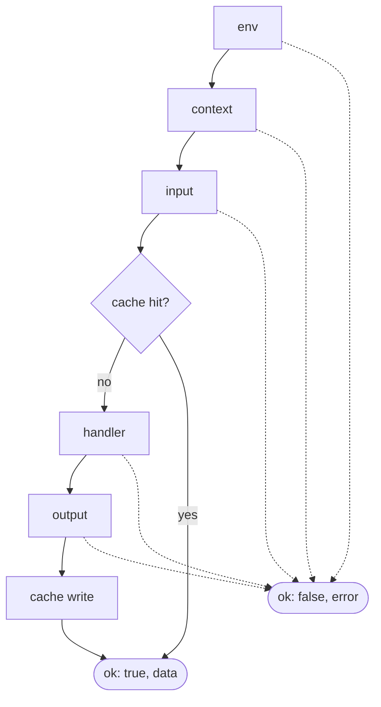

A Zagora procedure looks like any other function. You call it, it gives you something back. What it gives back is always a result, never an exception. That one promise shapes the whole design.

This page follows a single call from start to finish, and says why each step works the way it does.



## First, nothing runs

Before there's a call, there's a definition. Each builder method returns a new builder with one more piece of it, and nothing runs until `.callable()`, or until `.handler()` in auto-callable mode. So a half-built chain is just a value. You can export it, share it, and grow many procedures from one base.

```ts twoslash
import { z } from "zod";
import { zagora } from "zagora";
// ---cut---
const base = zagora().input(z.string());

const upper = base.handler((_, text) => text.toUpperCase()).callable();
const lower = base.handler((_, text) => text.toLowerCase()).callable();

upper("Ada");
// { ok: true, data: 'ADA', error: undefined }
lower("Ada");
// { ok: true, data: 'ada', error: undefined }
```

## Sync stays sync

The Zagora source has no `async` and no `await`. It checks each value at runtime and waits only when it actually gets a promise or a thenable. A sync handler with sync schemas hands you the result right away. An async handler makes the procedure return a `Promise`, and the type tells you so. You never pay for async you didn't ask for.

```ts twoslash
import { zagora } from "zagora";
// ---cut---
const syncProc = zagora()
  .handler(() => 1)
  .callable();

const asyncProc = zagora()
  .handler(async () => 1)
  .callable();

const a = syncProc();
// a result
const b = asyncProc();
// a Promise of a result
```

## The env goes first, and stays private

The first thing a call does is validate the env values, before it even looks at your arguments. A broken configuration then fails the same way on every call, whatever the input. You find out on the first try, not on the one odd input that happens to reach the bad code path.

Those values reach the handler through the options object, and nowhere else. The procedure keeps its definition on `~zagora` so tools can read its schemas, but the env values aren't in it. Anything that gets hold of the function can't read your secrets off it.

```ts twoslash
import { z } from "zod";
import { zagora } from "zagora";
// ---cut---
const hello = zagora()
  .context<{ user: string }>({ user: "guest" })
  .env(z.object({ GREETING: z.string() }), { GREETING: "Hi" })
  .handler(({ context, env }) => `${env.GREETING}, ${context.user}`)
  .callable({ context: { user: "Ada" } });

hello();
// { ok: true, data: 'Hi, Ada', error: undefined }
"envVars" in hello["~zagora"];
// false
```

The context in that example merges the same careful way. Plain objects merge key by key, and anything else, like a database client, replaces the initial value as it is, so it keeps its prototype.

## A tuple becomes real parameters

A tuple input schema gives the procedure one parameter per element. Zagora validates the tuple as one value, fills in the defaults of any missing trailing elements, and spreads the result into the handler. The types follow the runtime exactly. Only trailing elements that accept `undefined` become optional, so the signature you see is the one that actually works.

```ts twoslash
import { z } from "zod";
import { zagora } from "zagora";
// ---cut---
const introduce = zagora()
  .input(z.tuple([z.string(), z.number().default(18)]))
  .handler((_, name, age) => `${name} is ${age}`)
  .callable();

introduce("Ada");
// { ok: true, data: 'Ada is 18', error: undefined }
```

## The cache key comes from the source

With a cache adapter, Zagora hashes the whole call into a SHA-256 key: the validated arguments, every schema, and the source text of the handler. The source text was a deliberate choice. An in-memory ID per handler would change on every restart, so a shared cache like Redis could never reuse an entry across processes. Hashing the source keeps the key stable wherever the code runs.

A hit returns the stored value straight away, without validating it again. That's safe because of the last step.

## Every failure comes back as a value

The handler runs inside a try and catch. A failed schema, a thrown error, a rejected promise, a failing cache: each one comes back as `result.error`. The call itself never throws, even for strange values like a symbol `kind` or a getter that throws when you read it.

```ts twoslash
import { z } from "zod";
import { zagora } from "zagora";
// ---cut---
const parse = zagora()
  .input(z.string())
  .handler((_, text) => JSON.parse(text))
  .callable();

parse("{");
// { ok: false, isTypedError: false, error: { kind: 'UNKNOWN_ERROR', cause: SyntaxError, ... } }
```

## Typed errors are checked too

When the handler throws, Zagora reads the thrown value's `kind`. A declared kind with valid data becomes that [typed error](/guide/typed-errors). A declared kind with invalid data becomes a `VALIDATION_ERROR`, and anything else becomes an `UNKNOWN_ERROR`, with the original value in `cause`. Your errors get the same schema treatment as your data.

```ts twoslash
import { z } from "zod";
import { zagora } from "zagora";
// ---cut---
const findUser = zagora()
  .errors({ NOT_FOUND: z.object({ id: z.string() }) })
  .input(z.string())
  .handler(({ errors }, id) => {
    throw errors.NOT_FOUND({ id });
  })
  .callable();

findUser("7");
// { ok: false, isTypedError: true, error: { id: '7', kind: 'NOT_FOUND' } }
```

## Only valid output reaches the cache

With an output schema, Zagora validates what the handler returns, and a transform there shapes what the caller gets in `result.data`. Only after that check does anything get written to the cache. An invalid result never gets stored, so it can't come back on every later call. That ordering is what lets a cache hit skip validation.

```ts twoslash
import { z } from "zod";
import { zagora } from "zagora";
// ---cut---
const cache = new Map();
let runs = 0;

const double = zagora()
  .input(z.number())
  .handler((_, num) => {
    runs += 1;
    return num * 2;
  })
  .callable({ cache });

double(2);
double(2);
// runs === 1
```

## Why one result shape

Every step can fail, and every failure lands in the same frozen shape. You check `result.ok`, and TypeScript narrows the rest. There's no `try` block, no error class, no unwrap step. A test can assert on the result directly, and a router can map `error.kind` to a status code with one object. The [comparison](/comparison) page shows how that differs from neverthrow and Effect.

## Build up from functions

Zagora sits at the lowest level on purpose. Because a procedure is just a function, everything else is something you put on top, not something you have to start from.

An SDK is a plain object of procedures, which is all a [router](/recipes/routers) is. That's the same shape oRPC and tRPC give you, minus the network layer. When you need one, you put a [fetch handler](/recipes/http-handlers) in front, and nothing below it changes.

The cache works per function. Same arguments, same handler, same schemas means a hit, and the call skips validation and the handler entirely. And since the cache adapter, the context, and the env all come in through `.callable()`, you inject them like any dependency. Production gets Redis and a real database client. A [test](/recipes/testing) gets a `Map` and a stub, and asserts on the result.
